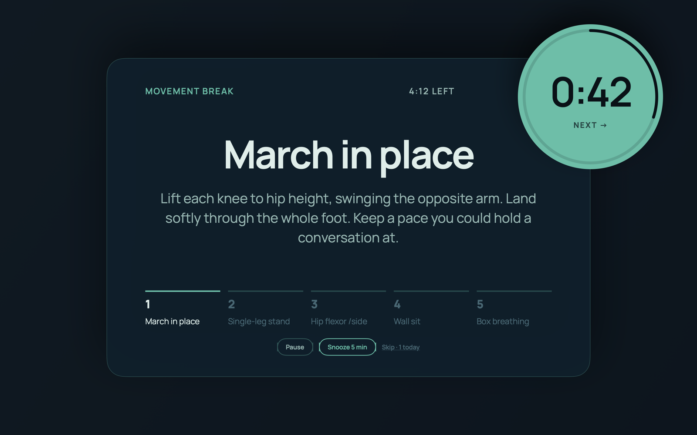
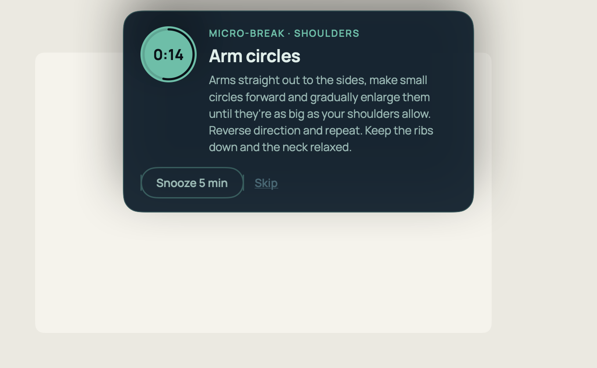
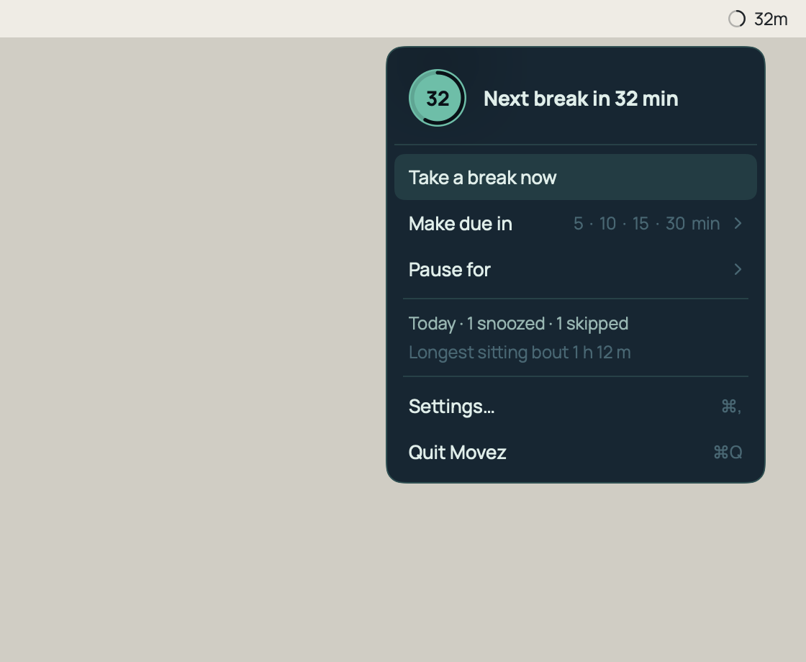

# Movez

**A macOS menu-bar app that gets you out of your chair.** Movez keeps count of how long you have
been sitting and, when it is time, dims the screen and walks you through a five-minute movement
break, then gets out of the way again.

> **⚠️ Status: under construction — not released.**
> Movez is unfinished, pre-release software. I'm sharing the source code so people can read and
> review it, not as a finished app for everyday use. If you build and run it, expect bugs, missing
> features and changes without notice, and expect it may not work as intended. Movez suggests
> physical movements: read the [Health, Safety and Terms of Use](HEALTH_AND_SAFETY.md) before running
> it, and use it entirely at your own risk. Provided "as is" under the [GPL-3.0-or-later](LICENSE), with no
> warranty. No official builds are published.



## What it does

- **Counts sitting, not typing.** Movez notices when you get up and when you come back, so a trip
  to the kitchen resets the count (or pauses it, if you prefer) and a long read at the desk does
  not.
- **A five-minute break when the time is up.** Pick 25, 55 (the default) or 85 minutes of sitting,
  or your own. A break is five one-minute movements: a circulation warm-up, then balance,
  flexibility and strength in a different order each time, and a closer for the hands, eyes or
  breathing.
- **One-minute micro-breaks** every 30 minutes on the longer settings, so no stretch of sitting
  runs much past half an hour.
- **A library of 174 movements**, most doable beside a desk. A movement doesn't come back the same day
  unless the library runs short, and what you did in the last few days is less likely to come
  round again.
- **Stays out of the way.** A break waits while your microphone is in use, while you share or
  record your screen, or while a full-screen app is in front. You get a minute's warning first,
  and can start early, snooze or skip. Set working hours, pause from the menu, or let a macOS Focus
  pause it.
- **Fits your space.** Tell it what equipment you have, whether there is a wall, floor space or
  stairs nearby, and how hard the movements may be; leave out any movement you don't want.
- **Private.** No account and no network access. Your settings and history stay on your Mac.

<p align="center">
  
  
</p>

## Why

Research on desk work points the same way: break up sitting at least every half hour, and a few
minutes of movement does more than standing up for a moment. Most break apps are built to rest
the eyes and wrists, treat "not typing" as resting, and are either easy to ignore or interrupt at
the worst moment. Movez tries to do the opposite: real movement, at a sensible time, and never in
the middle of a call. It is a reminder, not a treatment or a fitness program; see
[HEALTH_AND_SAFETY.md](HEALTH_AND_SAFETY.md).

## Try it

There is no download. Movez is pre-release and unsigned, so the only way to run it is to build it
yourself:

- a Mac with macOS 14 (Sonoma) or later, and Xcode 15 or later
- `brew install xcodegen swiftlint`
- read [HEALTH_AND_SAFETY.md](HEALTH_AND_SAFETY.md) first

```sh
git clone https://github.com/mack5imal/movez.git
cd movez
make run
```

That builds a Debug copy and opens it; Movez appears in the menu bar, not the Dock. To keep a copy
in Applications instead, see **Running a local build** under *For developers*.

## Health, safety and license

Movez suggests physical movements, including some with weights. Read
[HEALTH_AND_SAFETY.md](HEALTH_AND_SAFETY.md) before running it; you use it at your own risk.

Movez is free software: you can redistribute it and/or modify it under the terms of the
[GNU General Public License](LICENSE) as published by the Free Software Foundation, either
version 3 of the License, or (at your option) any later version. It is provided "as is", without
warranty of any kind.
Copyright © 2026 Kyle Mack.

The bundled Manrope font is under the SIL Open Font License 1.1.

## For developers

### Prerequisites

- macOS 14 or later, Xcode 15 or later (open it once so the toolchain is licensed)
- `brew install xcodegen swiftlint`

### Build, test, lint

```sh
make build      # generate movez.xcodeproj and build Debug
make test       # run the XCTest suite
make lint       # swiftlint --strict
make snapshots  # render every UI surface to PNG
make run        # launch the built app
make app        # print the path of the built .app
make hygiene    # open the break overlay on every display and check its window hygiene
make panel-hygiene  # show each floating panel and check it never takes focus
make assets     # re-fetch Manrope and regenerate the chimes
```

`make gen` alone regenerates `movez.xcodeproj` from `project.yml`. The generated project is
committed so the repo opens in Xcode without XcodeGen, but `project.yml` is the source of truth.

### Versions

Settings ends with a line like `Movez 0.5.0 (38) · library v4.2 · 174 movements`. Each part is read
from what is installed, so nothing else needs editing when one of them moves:

- **App version** (`0.5.0`): `MARKETING_VERSION` in `project.yml`, changed with
  `make version V=0.6.0`. A minor bump for a release with features, a patch bump for one with only
  fixes; 1.0 is reserved for when the app is called done.
- **Build number** (`38`): stamped on every build with the commit count (`git rev-list --count
  HEAD`), so it never needs bumping.
- **Library version** (`v4.2`): the `version` field of `movement-library-v4.json`. The filename
  keeps only the major version (a test holds them together), so a minor library revision touches
  the library file and nothing else.

### Running a local build (development)

Movez is pre-release, so there is no installer and no published build. For development and
review, `make run` launches the Debug app straight out of the build directory.

To try a Release build on your own Mac — at your own risk, and after reading
[HEALTH_AND_SAFETY.md](HEALTH_AND_SAFETY.md) — build it and copy it to a permanent location:

```sh
xcodebuild -project movez.xcodeproj -scheme movez -configuration Release \
  -destination 'platform=macOS' -derivedDataPath build/DerivedData build
ditto build/DerivedData/Build/Products/Release/movez.app /Applications/movez.app
open /Applications/movez.app
```

A permanent location matters only if you turn on Launch at Login: macOS records the app's path, so
a login item pointing into `build/` breaks at the next `make clean`. Re-run the same lines to pick
up a newer build.

### Repo layout

```
project.yml                 XcodeGen spec (source of truth for the Xcode project)
Makefile                    build / test / lint / snapshot entry points
Sources/movez/App           app entry point, delegate, coordinator, launch arguments
Sources/movez/Library       the movement library, decoded and validated
Sources/movez/Routine       routine and micro-break generation
Sources/movez/Scheduler     the sitting-to-break state machine (pure, clock-injected)
Sources/movez/Signals       idle, microphone, screen capture, fullscreen, power
Sources/movez/UI            design system and the five UI surfaces
Sources/movez/Resources     Info.plist, Manrope, chimes
Tests/movezTests            XCTest suite
scripts/                    font fetch and chime synthesis
```

The Markdown and JSON documents at the repository root — `product-brief-v1.md`,
`scheduler-research-v1.md`, `movement-library-v4.json` and the `design_handoff_movez_ui/`
folder — are the source of truth for behaviour and visual design.
`movement-library-v4.json` is bundled into the app directly from the repository root; there is
no second copy to keep in sync.

### The surfaces

`make snapshots` renders every one of them offscreen, at 2×, from frozen fixtures. That is how a
screen is reviewed without waiting an hour for a break to come round.

| Surface | What it is |
|---|---|
| `gallery` | Every colour, type style and control in the design system on one sheet |
| `overlay-full`, `overlay-collapsed`, `overlay-side`, `overlay-end` | The full break, shown on every display: a movement running, an instruction the user has collapsed, a per-side movement, and the end card |
| `headsup`, `headsup-deferred` | The minute before a break, and the variant for a break that waited for a call |
| `micro-countin`, `micro-running` | The micro-break's thirty-second count-in and its minute |
| `toast` | "Away 7 min · break timer reset", with "I was sitting" to undo it |
| `menu-sitting`, `menu-paused`, `menu-offhours`, `menu-icon` | The dropdown in each mode, and the menu-bar glyph at five moments |
| `settings`, `settings-hours`, `settings-library`, `settings-exceptions`, `settings-custom` | The settings window and its three sheets, plus the custom preset |
| `debug` | The settings window with the debug disclosure open |

### Known limitations

- **Screen-capture detection is a heuristic** — see the note below. It will miss a tool that is
  not in `capture-signatures.json`.
- **Fullscreen detection is a guess about intent.** A maximised editor looks exactly like a
  presentation, which is what the per-app exceptions list in Settings is for.
- **Launch at login needs the app to live somewhere permanent.** `SMAppService` records the
  bundle's path, so an app registered out of `build/DerivedData` stops launching the moment
  `make clean` removes it. Copy it to a permanent location (see **Running a local build** above) before turning the toggle on.
  Registration itself does not need a Developer ID: on macOS 15.6 an ad-hoc signature with no
  team identifier registers fine, and the login item survives a rebuild that changes the code
  hash. Should macOS refuse anyway, Movez shows the refusal under the toggle rather than letting
  it silently spring back.
- **Working hours are one window a day.** A split shift has to be handled by pausing.
- **The break overlay covers every display but the menu bar.** That is deliberate: a break must
  never trap the user.
- **The app is unsandboxed**, for the reasons in the notes below.

### Notes

- The app runs as an `LSUIElement` agent: it has a menu-bar item and no Dock icon.
- App Sandbox is **off**. Movez inspects the frontmost window and the running process list to
  tell whether you are presenting or screen-sharing, and reads microphone activity state, all of
  which the sandbox blocks. It makes no network calls and writes only to its own Application
  Support directory.
- **Screen-capture detection is a heuristic.** macOS has no public API that reports whether the
  screen is being recorded or shared, so Movez watches for the tools people actually use
  (`Sources/movez/Resources/capture-signatures.json`). It is deliberately conservative: a false
  positive silently postpones a break, which is worse than missing one share. Tools that sit in
  the menu bar all day — Loom, CleanShot X, Kap — are listed but disabled, because their merely
  running says nothing about whether a recording is live. Zoom and Teams run all day too, but
  both spawn a share helper that exists only while a share is live, so they are gated on that.
  Add your own signatures to that file if you use something else.
- **Focus.** There is no supported way to read the current Focus, so Movez ships a Focus Filter
  instead: System Settings → Focus → *your Focus* → Focus Filters → Add Filter → Movez. Turn
  "Pause breaks" on and Movez waits until that Focus ends.
- `movez --probe-signals` prints one line per monitor for five seconds, which is how to check the
  adapters on a new machine. `movez --smoke` is the build's readiness check.
- **Run `--overlay-hygiene` through `open`, not the raw binary** (`make hygiene` does). macOS 14
  grants activation rights through Launch Services; a binary exec'd from a shell never becomes the
  active app, so its overlay can never take keyboard focus and the check reports `key=false` even
  though the shipped app is fine.
- `movez --panel-hygiene` shows each floating panel for a second and fails if any of them moves
  the frontmost app, activates Movez, or lands off its specified inset. Unlike the overlay check
  it is run straight from the binary, because not activating is the whole point.
- Idle CPU sits at roughly 0.5% while Movez is counting down, and at nothing at all while it is
  paused or off hours: the signal monitors stop entirely rather than polling into a void.
- Manrope is bundled under the SIL Open Font License 1.1 (`Sources/movez/Resources/Fonts/OFL.txt`).
- The chimes are synthesised locally by `scripts/gen_chimes.py`; no audio is downloaded.
